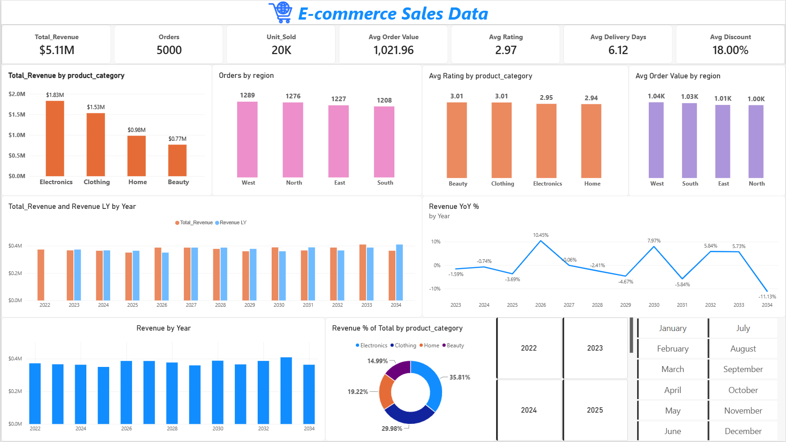
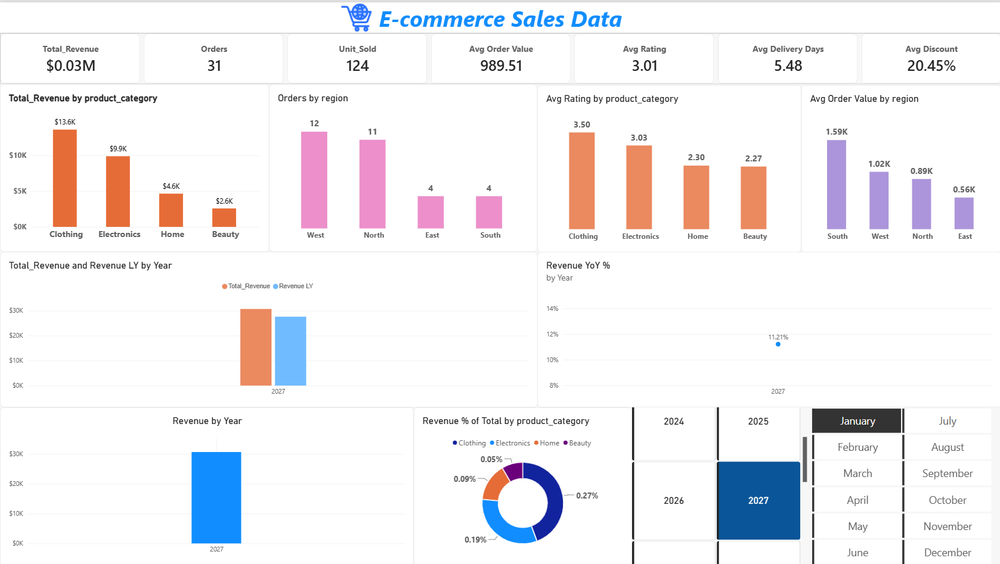

# E-commerce Sales Dashboard (Power BI)

An interactive Power BI report built on a Kaggle e-commerce dataset of 5,000 orders.

Skills used: Power Query cleaning, a custom calendar table, and DAX measures.

*Example: report filtered to January 2027 using the year and month slicers.*

## What's in the report
- 7 KPI cards and 8 visuals
- Year and month slicers
- Time intelligence: year-over-year comparison and YTD

## Data
Source: [E-Commerce Sales Dashboard](https://www.kaggle.com/datasets/abbas829/ecommerce-sales-dataset). Practice data, so the findings are not business conclusions.

## What I did
1. **Cleaned the data in Power Query.** Fixed mixed date formats where day and month were swapped.
2. **Built a custom calendar table** and related it to the sales table.
3. **Wrote DAX measures** (see [docs/dax_measures.md](docs/dax_measures.md)): CALCULATE, ALL, SAMEPERIODLASTYEAR, TOTALYTD.
4. **Designed the report** on a single 16:9 page.

## Key insights
- Electronics generated the most revenue (about 36%), followed by Clothing (about 30%).
- Orders were evenly spread across the four regions.
- Average order value about $1,022; average rating 2.97.

## Lessons learned
- Relationship cardinality and filter direction in the data model.
- Why a YTD measure needs a single year in context.

## How to open
Download [report/ecommerce_sales_dashboard.pbix](Report) and open it in Power BI Desktop.
